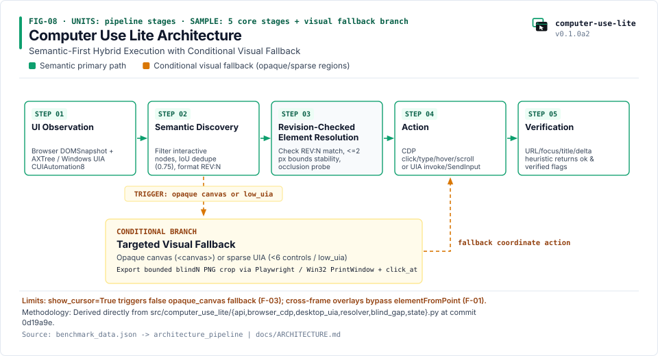
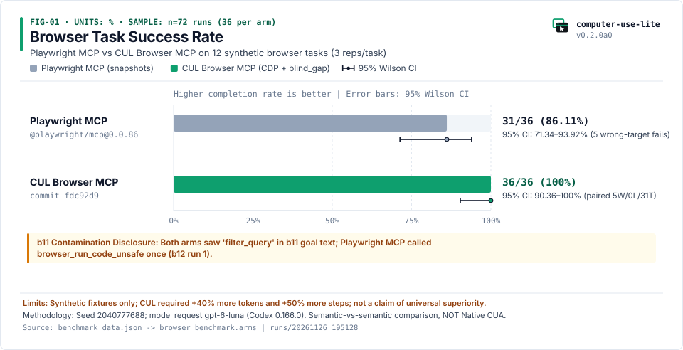
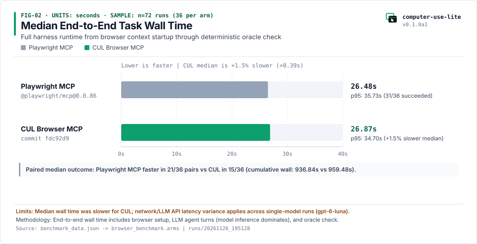
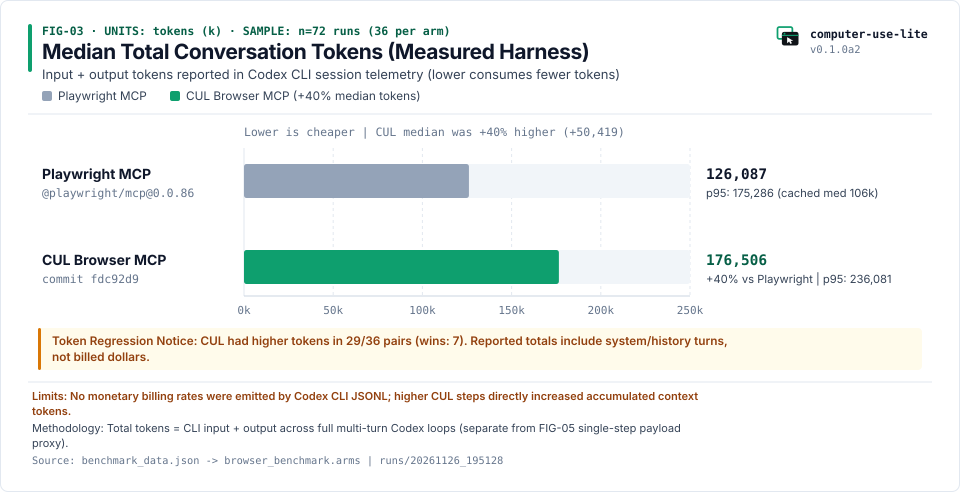
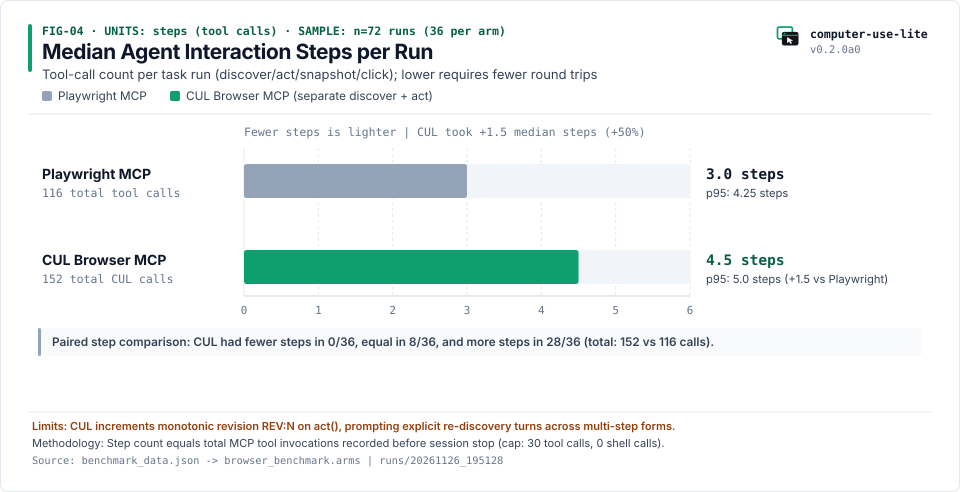
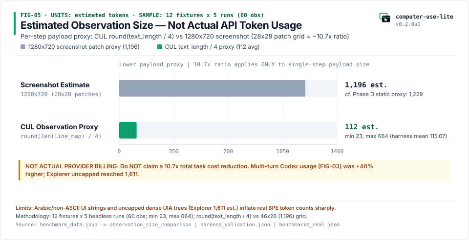
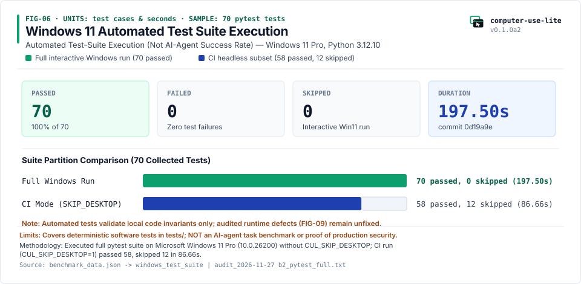
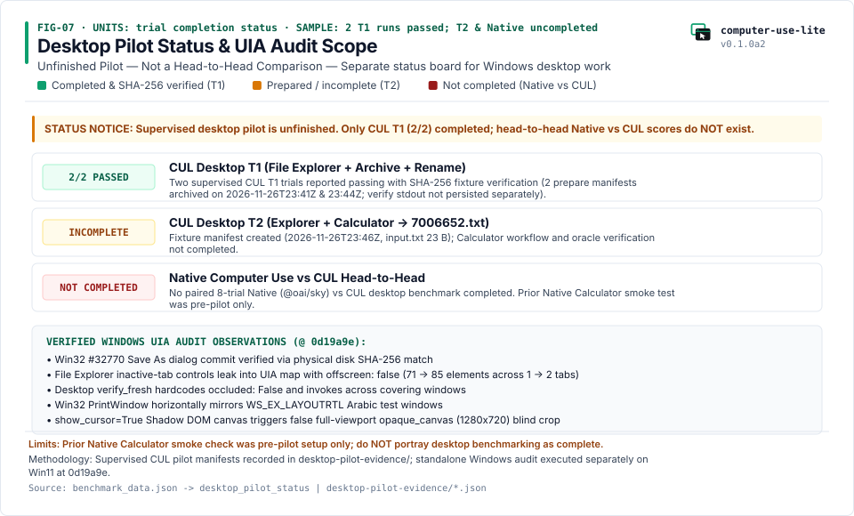
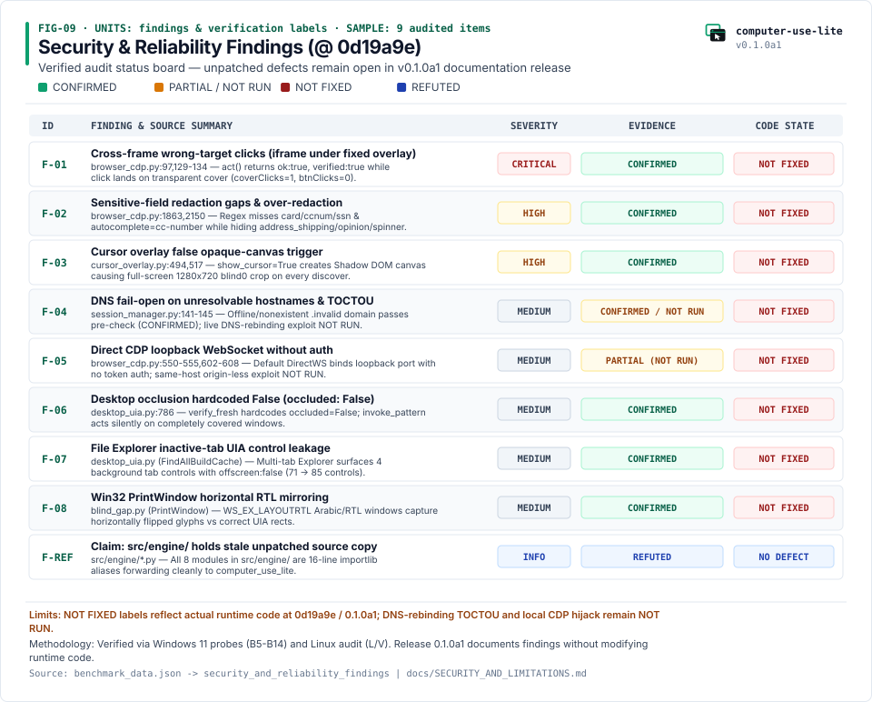

<p align="center">
  
</p>

<h1 align="center">Computer Use Lite (CUL)</h1>

<p align="center">
  <strong>Semantic-first browser (CDP) and Windows desktop (UIA) interaction engine for AI agents — with targeted visual fallback only where structure is unavailable.</strong>
</p>

<p align="center">
  <strong>Version:</strong> <code>0.1.0a2</code> (Benchmark Research Edition; Historical Baseline: <a href="https://github.com/mohgomaa-art/computer-use-lite/releases/tag/v0.1.0a0"><code>v0.1.0a0</code> @ <code>0d19a9e</code></a>) ·
  <strong>License:</strong> <a href="LICENSE">Apache-2.0</a> ·
  <strong>Author:</strong> Mohamed Gomaa (<a href="https://github.com/mohgomaa-art/"><code>@mohgomaa-art</code></a>)
</p>

> [!WARNING]
> **Experimental Research Preview — Not Production Ready (`v0.1.0a2`):** This release adds canonical benchmark data, reproducible TypeScript/SVG visual figures, official branding, Windows MCP setup tooling, and security documentation over runtime baseline `0d19a9e`. **Core runtime engine bugs remain NOT FIXED in this release** — including cross-frame overlay click-through (`Critical`), sensitive-field redaction gaps (`High`), cursor-overlay false `opaque_canvas` detection (`High`), DNS fail-open / TOCTOU (`Medium`), and unauthenticated loopback CDP (`CUL_MCP_DIRECT_WS` enabled by default). **Do not deploy against untrusted hosts or arbitrary public browsing.** See [docs/SECURITY_AND_LIMITATIONS.md](docs/SECURITY_AND_LIMITATIONS.md) and [SECURITY.md](SECURITY.md).

---

## 1. Overview & Status

**Computer Use Lite (`computer-use-lite`)** reduces repetitive per-step screenshot capture on structured UIs by discovering interactive elements directly from Chromium DevTools Protocol (`DOMSnapshot.captureSnapshot` + `Accessibility.getFullAXTree`) and scoped Windows UI Automation (`CUIAutomation8` COM MTA), binding actions to short `eN` identifiers validated against monotonic `REV:N` revisions and bounds stability checks before dispatching input, and invoking cropped PNG screenshots (`blindN`) only for unmapped `<canvas>` or sparse-UIA (`low_uia`) surfaces.

- **Canonical Benchmark Dataset:** [research_archive/benchmark_publication/benchmark_data.json](research_archive/benchmark_publication/benchmark_data.json)
- **Visual Source Code (TSX/React):** [research_visuals/benchmark_report/](research_visuals/benchmark_report/) (isolated from Python dependencies)
- **Publication Documentation:** [docs/BENCHMARK_COMPARISON.md](docs/BENCHMARK_COMPARISON.md) · [docs/BENCHMARK_METHODOLOGY.md](docs/BENCHMARK_METHODOLOGY.md) · [docs/SECURITY_AND_LIMITATIONS.md](docs/SECURITY_AND_LIMITATIONS.md) · [docs/INDEX.md](docs/INDEX.md)

---

## 2. Architecture Overview (`FIG-08`)



*Source TSX: [`Fig08Architecture.tsx`](research_visuals/benchmark_report/src/figures/Fig08Architecture.tsx) · Deep Dive: [docs/ARCHITECTURE.md](docs/ARCHITECTURE.md)*

---

## 3. Browser Agent Benchmark Comparison (`FIG-01` – `FIG-04`)

Evaluated across **`72` randomized runs** (`12` synthetic local HTML tasks × `3` repetitions × `2` arms, seed `2040777688`, Codex CLI `0.166.0`, requested model `gpt-6-luna`) comparing **`@playwright/mcp@0.0.86`** against **CUL Browser MCP** at commit `fdc92d9` (`CUL_MCP_BROWSER_ONLY=1`). **This is a semantic-vs-semantic browser MCP comparison, NOT Native OpenAI Computer Use (`@oai/sky`) vs CUL.**

| Metric | Playwright MCP (`n=36`) | CUL Browser MCP (`fdc92d9`, `n=36`) | Delta / Caveat |
|---|---:|---:|---|
| **Successful runs** | `31/36` (`86.11%`) | `36/36` (`100.0%`) | `+5` CUL wins on `b08` (`0/3 -> 3/3`) & `b12` (`1/3 -> 3/3`); `b11` shared prompt leaked `filter_query` |
| **Median total tokens** | `126,087` | `176,506` | **CUL `+40.0%` higher** (`7` wins / `29` losses) |
| **Median steps** | `3.0` | `4.5` | **CUL `+50.0%` more tool calls** (`152` vs `116` total) |
| **Median wall time** | `26.48s` | `26.87s` | **CUL `+1.5%` slower median** (`26,869.85 ms` vs `26,480.53 ms`) |

<p align="center">
  
</p>

*FIG-01 Source TSX: [`Fig01BrowserSuccess.tsx`](research_visuals/benchmark_report/src/figures/Fig01BrowserSuccess.tsx) · Methodology: [docs/BENCHMARK_METHODOLOGY.md](docs/BENCHMARK_METHODOLOGY.md)*

<p align="center">
  
</p>

*FIG-02 Source TSX: [`Fig02WallTime.tsx`](research_visuals/benchmark_report/src/figures/Fig02WallTime.tsx) · Methodology: [docs/BENCHMARK_METHODOLOGY.md](docs/BENCHMARK_METHODOLOGY.md)*

<p align="center">
  
</p>

*FIG-03 Source TSX: [`Fig03TokenEstimates.tsx`](research_visuals/benchmark_report/src/figures/Fig03TokenEstimates.tsx) · Methodology: [docs/BENCHMARK_METHODOLOGY.md](docs/BENCHMARK_METHODOLOGY.md)*

<p align="center">
  
</p>

*FIG-04 Source TSX: [`Fig04InteractionSteps.tsx`](research_visuals/benchmark_report/src/figures/Fig04InteractionSteps.tsx) · Full Breakdown: [docs/BENCHMARK_COMPARISON.md](docs/BENCHMARK_COMPARISON.md)*

> [!NOTE]
> **Disclosed Confounds:** (1) `b11_dense_90_grid_filter` shared goal text exposed CUL's `filter_query` parameter name to both arms; (2) Playwright MCP invoked `browser_run_code_unsafe` once on `b12_opaque_canvas_click` run 1; (3) CUL Browser MCP ran on benchmark worktree commit `fdc92d9`; (4) tasks were synthetic local fixtures and do not establish general CUL superiority.

---

## 4. Observation-Size Proxy Comparison (`FIG-05`)

<p align="center">
  
</p>

*FIG-05 Source TSX: [`Fig05ObservationSize.tsx`](research_visuals/benchmark_report/src/figures/Fig05ObservationSize.tsx) · Methodology: [docs/BENCHMARK_METHODOLOGY.md](docs/BENCHMARK_METHODOLOGY.md#3-observation-size-proxy-fig-05)*

> [!CAUTION]
> **Estimated Observation Size — Not Actual API Token Usage:** `112` estimated tokens (`round(text_length / 4)`) vs `1,196` `28×28`-patch tokens (`1280×720`) reflects single-step payload estimates on synthetic browser tasks, **not** provider BPE billing or a `10.7x` reduction in total task cost (cf. `FIG-03`, where total multi-turn Codex tokens were `+40%` higher, and uncapped File Explorer UIA at `1,611.0` est. tokens).

---

## 5. Windows Automated Test Coverage (`FIG-06`)

<p align="center">
  
</p>

*FIG-06 Source TSX: [`Fig06WindowsTests.tsx`](research_visuals/benchmark_report/src/figures/Fig06WindowsTests.tsx) · Provenance: [benchmark_sources.json](research_archive/benchmark_publication/benchmark_sources.json)*

Measured on Windows 11 Pro (`10.0.26200`) at commit `0d19a9e`: **`70 passed, 0 failed, 0 skipped` in `197.50s`** (`58 passed, 12 skipped` in `86.66s` with `CUL_SKIP_DESKTOP=1`). This measures deterministic suite health, not AI-agent success.

---

## 6. Desktop Pilot Status (`FIG-07`)

<p align="center">
  
</p>

*FIG-07 Source TSX: [`Fig07DesktopPilotStatus.tsx`](research_visuals/benchmark_report/src/figures/Fig07DesktopPilotStatus.tsx) · Details: [docs/BENCHMARK_COMPARISON.md](docs/BENCHMARK_COMPARISON.md#4-desktop-pilot-status-fig-07)*

Supervised desktop benchmarking remains **incomplete**: `CUL T1` passed `2/2` runs with SHA-256 fixture checks, **`CUL T2` remained incomplete**, and the **Native (`@oai/sky`) vs CUL head-to-head comparison was not completed**.

---

## 7. Verified Security & Reliability Findings (`FIG-09`)

<p align="center">
  
</p>

*FIG-09 Source TSX: [`Fig09SecurityFindings.tsx`](research_visuals/benchmark_report/src/figures/Fig09SecurityFindings.tsx) · Full Security Dossier & Evidence Captures: [docs/SECURITY_AND_LIMITATIONS.md](docs/SECURITY_AND_LIMITATIONS.md)*

All runtime issues (`F-01`–`F-08`) verified on `0d19a9e` remain **unfixed** in `0.1.0a2`; the stale `src/engine/` copy claim was **`REFUTED`** (`16`-line `importlib` aliases).

---

## 8. Installation & Quick Start

**Requirements:** Windows 10/11 (`desktop_uia.py`, `snapshot.py`, and `desktop_cursor_overlay.py` bind Windows Win32/COM libraries on import) and Python `>=3.10`.

### Option A — Guided Windows MCP Setup (`Codex`, `Antigravity`, `Claude Code`)

For one-step setup using an isolated repository-local `.venv`, installing `.[setup]` (`tomlkit`), and safely merging the `computer_use_lite` stdio entry into **Codex**, **Antigravity**, and **Claude Code** configs with automatic timestamped backups, see **[docs/WINDOWS_MCP_SETUP.md](docs/WINDOWS_MCP_SETUP.md)** or run from the repository root:

```bat
scripts\setup_mcp_windows.bat
```

### Option B — Editable Developer & Benchmark Install

```powershell
git clone https://github.com/mohgomaa-art/computer-use-lite.git
cd computer-use-lite

python -m pip install -e ".[dev,benchmarks]"
python -m playwright install chromium
```

> Note: Installing extras `.[dev]` alone omits `psutil` needed by benchmark tests; use `".[dev,benchmarks]"` for full benchmark/test execution or `".[setup]"` when running [`scripts/configure_mcp.py`](scripts/configure_mcp.py).

### Python API (Browser) & MCP Server (`stdio`)

```python
from pathlib import Path
from computer_use_lite import Api, BrowserSession, __version__

print("computer-use-lite:", __version__)
with BrowserSession(url="https://example.com", headless=True, viewport=(1280, 720)) as session:
    api = Api(session, state_path=Path("./runtime/task_state.json"), crops_dir=Path("./runtime/crops"))
    print(api.discover_interactables(max_elements=60))
    print(api.execute_action("e1", "click", revision=1))
```

Launch the `13`-tool MCP server (`stdio`):

```powershell
computer-use-lite-mcp
# or:
python -u -m computer_use_lite.mcp_server
```

Run tests (`CUL_SKIP_DESKTOP=1` matches CI; omit only on an interactive unlocked Windows desktop):

```powershell
$env:CUL_SKIP_DESKTOP = "1"
pytest -v -rs --strict-markers -W error::pytest.PytestReturnNotNoneWarning
```

Reproduce TSX/SVG chart generation independently (requires Node `>=20`, zero Python runtime impact):

```powershell
cd research_visuals/benchmark_report
npm install
npm run build
npm run export
```

---

## 9. Documentation, Version History & Citation

- **Documentation Hub:** [docs/INDEX.md](docs/INDEX.md)
- **Research Publication Docs:** [docs/BENCHMARK_COMPARISON.md](docs/BENCHMARK_COMPARISON.md) · [docs/BENCHMARK_METHODOLOGY.md](docs/BENCHMARK_METHODOLOGY.md) · [docs/SECURITY_AND_LIMITATIONS.md](docs/SECURITY_AND_LIMITATIONS.md)
- **Historical & Audit Archive:** [research_archive/INDEX.md](research_archive/INDEX.md) · [research_archive/benchmark_publication/benchmark_data.json](research_archive/benchmark_publication/benchmark_data.json)
- **Version History:** See [CHANGELOG.md](CHANGELOG.md) (`v0.1.0a2` Benchmark Research Edition, intermediate `v0.1.0a1`, and immutable historical release [`v0.1.0a0`](https://github.com/mohgomaa-art/computer-use-lite/releases/tag/v0.1.0a0) at `0d19a9e`).
- **Citation:** See [CITATION.cff](CITATION.cff) (`version: "0.1.0a2"`), [AUTHORS.md](AUTHORS.md), [LICENSE](LICENSE), and [NOTICE](NOTICE).
