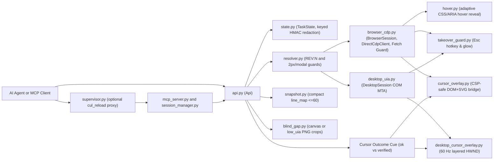

# Architecture (`v0.2.0a0+`)

Computer Use Lite (CUL) pairs a semantic discovery/resolution API (`Api` + `Resolver`) with Chromium CDP and Windows UI Automation backends, on-demand visual gap crops (`blind_gap`), atomic HMAC-redacted step logging (`TaskState`), a `stdio` Model Context Protocol server (`mcp_server` + `session_manager`, optionally supervised by `supervisor` for mid-session reloads), physical interrupt safeguards (`takeover_guard`), and an optional Frosted Obsidian-Glass & Satin Chrome 3D cursor overlay (`cursor_overlay` + `desktop_cursor_overlay`).

---

## 1. High-Level Component Flow



---

## 2. Module Responsibilities (`src/computer_use_lite/`)

All `15` Python modules inside `src/computer_use_lite/` (`__init__.py` plus `14` implementation modules):

| Module | Verified Responsibilities (`[VERIFIED-CODE]`) |
| :--- | :--- |
| [`api.py`](../src/computer_use_lite/api.py) | Implements `discover_interactables()` (`include_static_text` option), `read_page()`, `inspect_element()` (rich live metadata + `"[REDACTED]"` on sensitive inputs), `execute_action()` (`click`/`type`/`focus`/`drag`, `verify_fresh(tolerance=2)`, outcome cursor cues `_notify_cursor_outcome`), `hover_element()`, `line_map()` (`DEFAULT_LINE_MAP_CAP = 60`, `DIALOG_ALERT:` lines for `#32770`), and `last_stats`. |
| [`browser_cdp.py`](../src/computer_use_lite/browser_cdp.py) | Manages Chromium lifecycle (`BrowserSession`), Playwright Pipe IPC by default with opt-in `DirectCdpClient` WebSocket transport (`CUL_MCP_DIRECT_WS=1`), loopback exact-port `--remote-debugging-address=127.0.0.1` + `--remote-allow-origins=http://127.0.0.1:<port>`, browser/page CDP `Fetch` SSRF interception + IP drift detection, Playwright context multi-tab tracking (`switch_tab`, `close_tab`, `tabs`), 2-call `DOMSnapshot` + `AXTree` discovery, `overflow` ancestor + `<label>` pruning, candidate-only paint-order occlusion, top-frame `DOM.getNodeForLocation` verification, `drag_coordinate`, `type_text`, and targeted `scroll(x, y)`. |
| [`desktop_uia.py`](../src/computer_use_lite/desktop_uia.py) | **Windows-only at runtime (guarded top-level imports for Linux portability):** dedicated `COINIT_MULTITHREADED` worker running `CUIAutomation8` (`IUIAutomation2` with `AutoSetFocus=0`), `4`-attempt transient `COMError` UIA scan retries, single-HWND `FindAllBuildCache` discovery excluding inactive Explorer tabs, `#32770` static alert collection and `_commit_dialog_text`, left-modifier VKs (`0xA0`/`0xA2`/`0xA4`) with scan codes & `KEYEVENTF_EXTENDEDKEY`, concatenated numpad aliases, shared `CursorCoordinator` / `KillSwitch` (`5 px` tolerance), Z-order + DWM cloaking `verify_fresh`, `IsIconic`-guarded `_ensure_foreground`, `drag_coordinate`, `type_text` (`unicode`/`vk_scan`), and `list_windows()`. |
| [`cursor_overlay.py`](../src/computer_use_lite/cursor_overlay.py) | Defines `DESIGN_TOKENS` (Frosted Obsidian-Glass & Satin Chrome, `64x64` artboard, `315` deg key light, `+2.2/+3.0` extrusion offset, `1.6 px` rim), `26+` vector `CURSOR_SPECS`, `resolve_overlay_enabled()`, `resolve_glide_ms()`, `cursor_for_action()`, and a CSP/Trusted-Types-safe DOM+SVG injection bridge for Chromium (`CUL_AGENT_CURSOR`, `CUL_AGENT_CURSOR_GLIDE_MS`). |
| [`desktop_cursor_overlay.py`](../src/computer_use_lite/desktop_cursor_overlay.py) | **Windows-only at runtime (guarded Win32 imports):** renders the 3D cursor onto a dedicated click-through `WS_EX_LAYERED \| WS_EX_TRANSPARENT \| WS_EX_TOPMOST \| WS_EX_NOACTIVATE` overlay HWND pumped on its own `60.0 Hz` Win32 GUI thread (`DesktopCursorOverlay`), using `_WDA_EXCLUDEFROMCAPTURE` (`0x00000011`) capture exclusion and zero `SendInput` pointer glides so `KillSwitch` never false-triggers (`resolve_desktop_overlay_enabled`, `resolve_desktop_glide_ms`, `is_overlay_hwnd`). |
| [`takeover_guard.py`](../src/computer_use_lite/takeover_guard.py) | Coordinates `CUL_TAKEOVER_GLOW=1` desktop/browser takeover interruption state, physical `Esc` abort handling (`UserInterruptedError`), and guarded action scopes (`takeover_action_scope`). |
| [`resolver.py`](../src/computer_use_lite/resolver.py) | Binds `eN` element IDs to monotonic `REV:N`, verifies `tolerance=2` px drift / disabled / occluded / removed checks (`assert_fresh`), raises `StaleElementError`, and reconciles hover delta controls while preserving surviving sibling IDs. |
| [`snapshot.py`](../src/computer_use_lite/snapshot.py) | Assigns deterministic `e1`, `e2`, ... short IDs, tracks monotonic revisions (`bump_revision`), queries Win32 window bounds/titles (with guarded Win32 DLL loading for Linux import compatibility). |
| [`blind_gap.py`](../src/computer_use_lite/blind_gap.py) | Detects `opaque_canvas` (`>= 25%` viewport), `small_opaque_canvas` (`>= 5%` with `<= 2` nearby controls), and desktop `low_uia` (`< 6` interior controls excluding OS titlebar chrome on area `>= 200,000 px^2`). Captures PNG crops ordering `PrintWindow` (with `WS_EX_LAYOUTRTL` un-mirroring) before `ImageGrab` when `hwnd` is covered, non-foreground, minimized, or `DWMWA_CLOAKED`. |
| [`hover.py`](../src/computer_use_lite/hover.py) | Performs hover after freshness validation, polls adaptively up to `wait_ms` (`350` ms default), re-discovers, reconciles disappeared IDs, and returns newly revealed `added` objects. |
| [`state.py`](../src/computer_use_lite/state.py) | Atomic temp-file `TaskState` persistence (`mkstemp` + `os.replace`, configurable `fsync=True|False`), delimited word/camelCase `is_sensitive_name` detection, per-process ephemeral HMAC redaction (`hmac:<16hex>`), `[UNTRUSTED_UI_TEXT]` sanitization (`sanitize_ui_text`), blocked OS hotkeys (`validate_key_spec`), sensitive desktop blocklist (`validate_desktop_target`), and `validate_type_text_args`. |
| [`mcp_server.py`](../src/computer_use_lite/mcp_server.py) | `FastMCP` `stdio` server isolating `sys.stdout` to `sys.stderr`, exposing `15` core tools with strict Pydantic `extra="forbid"` (`additionalProperties: false`) validation and `ToolAnnotations`, resolving `CUL_MCP_HEADFUL`, emitting `HEADLESS:`, `CURSOR:`, `FG_MATCH:`, `IMAGES_UNCHANGED:` headers + `list_sessions()` metadata, and appending up to `4` inline `ImageContent` crops. |
| [`session_manager.py`](../src/computer_use_lite/session_manager.py) | Per-session FIFO `_SessionWorker` thread isolation (`MAX_SESSIONS=16`, idle TTL reaping `CUL_SESSION_IDLE_TTL_S`, `MAX_INLINE_BLIND_IMAGES=4`), disposable scratch `task_state.json` (`fsync=False`) + `crops/`, fail-closed URL & IPv4/IPv6/6to4/Teredo/NAT64 SSRF validation (`validate_navigation_url`), shared `CursorCoordinator` lifecycle, `skip_unchanged_images` hashing, and `atexit` cleanup. |
| [`supervisor.py`](../src/computer_use_lite/supervisor.py) | Pure-stdlib reloadable `stdio` MCP proxy exposing synthetic `cul_reload` (`16` tools supervised) with pre-booted candidate handshake, Win32 Job Object / POSIX process-group cleanup, stale-`.pyc` bypass, `-32603` fast-fail, exponential backoff, and non-destructive temp LKG rollback ([`MCP_SUPERVISOR_RELOAD.md`](architecture/MCP_SUPERVISOR_RELOAD.md)). |
| [`__init__.py`](../src/computer_use_lite/__init__.py) | Exports `Api`, `BrowserSession`, `DesktopSession`, `Resolver`, `StaleElementError`, `detect`, `export`. |
| `src/engine/*.py` | Backwards-compatibility module shims re-exporting core engine modules (`api`, `blind_gap`, `browser_cdp`, `desktop_uia`, `hover`, `resolver`, `snapshot`, `state`). |

---

## 3. Perception, Control & Wire Format Lifecycle

### Discovery & Wire Format (`discover` / `discover_interactables`)
1. **Scan:** Browser executes 2-call CDP `DOMSnapshot.captureSnapshot` + `Accessibility.getFullAXTree` (`browser_cdp.py`); Desktop executes single-HWND `FindAllBuildCache` `ControlView` scan (`desktop_uia.py`, excluding inactive Explorer tabs with `4`-attempt transient `COMError` backoff).
2. **Prune & Merge:** Filters out-of-viewport, occluded, and scroll-ancestor-clipped controls, deduplicates matching `<label for=...>` and clickable wrappers, and preserves `15` interactive ARIA/UIA roles (`resolver.INTERACTIVE`).
3. **Line Map Output:** Increments `REV:N`, detects `blind_gap` regions (skipping crops when `export_crops=False`, omitting duplicate inline PNG bytes when `skip_unchanged_images=True`), and emits compact sanitized text (`api.py` & `mcp_server.py`):
   ```text
   SESSION:<id> | KIND:<browser|desktop> | ... | HEADLESS:<bool> | CURSOR:<on|off> | LATENCY_MS:<ms> | TOKENS_EST:<n>
   REV:<n> | WIN:<surface> | ELEMENTS:<count> | BLIND_REGIONS:<count>
   DIALOG_ALERT:[UNTRUSTED_UI_TEXT] <static_text> [/UNTRUSTED_UI_TEXT]
   e1|button|Sign in|420,180,96,36|click
   ... +<m> more elements (use filter_query= or inspect_element)
   blind0|opaque_canvas||260,120,760,420|crop -> <path>
   ```

### Pre-Action Verification & Execution (`act` / `execute_action`)
1. `Resolver` validates `revision == current_revision`.
2. Target backend runs `verify_fresh(rec, tolerance=2)` (re-checking DOM connection / UIA presence, bounds drift `<= 2` px, disabled state, browser `elementFromPoint` / top-frame compositor hit-testing, and desktop Z-order + DWM cloaking -> `StaleElementError` on failure).
3. Action executes (Browser CDP/Playwright or Desktop UIA patterns -> `#32770` `_commit_dialog_text` / `SendInput`), then `state.verify(before, after, action=...)` checks target & page signature deltas (`verified` telemetry) and notifies cursor outcome cues (`ok` vs `verified`).
4. Mutating calls (`act`, `navigate` except `list_tabs`, `scroll`, `press_key`, `click_at`, `drag_at`, `type_text`) advance `REV:N` so older sibling IDs cannot be reused blindly; `hover` updates surviving sibling IDs in place at the new revision.

---

## 4. Cursor Overlay Architecture (`Workstream A`)

- **Trigger & Configuration:** Headless `open_browser` runs keep the overlay disabled (`resolve_overlay_enabled(headless=True) -> False`) unless `show_cursor=True` or `CUL_AGENT_CURSOR=1` is passed; headful browser sessions (`headless=False` or `CUL_MCP_HEADFUL=1`) and Windows `DesktopSession` runs enable the overlay by default unless `CUL_AGENT_CURSOR=0` or `CUL_SKIP_DESKTOP=1`. Glide speed defaults to `0 ms` (headless), `140 ms` (headful browser), and `160 ms` (desktop), clamped to `0..600 ms` (`CUL_AGENT_CURSOR_GLIDE_MS`).
- **Browser Isolation:** Uses DOM APIs and SVG vector elements inside `cursor_overlay.py` so strict CSP and Trusted Types policies do not break injection; excluded from both discovery parsing and `<canvas>` blind-region detection (`test_zero_discovery_leakage_*`).
- **Desktop Isolation:** Runs `DesktopCursorOverlay` on a dedicated `60.0 Hz` Win32 GUI message loop rather than `DesktopSession`'s COM MTA thread, flags the window `WS_EX_TRANSPARENT | WS_EX_NOACTIVATE | WS_EX_TOPMOST | WS_EX_LAYERED` plus `_WDA_EXCLUDEFROMCAPTURE`, and animates cursor frames cleanly without moving OS pointer hardware (`SendInput` never invoked during glides).

---

## 5. Multi-Tab & Security Boundaries (`P0-2`, `P0-4`, `P0-5` & Post-Audit Hardening)

- **Multi-Tab Context Tracking (`P0-2`):** `BrowserSession._bind_context_pages` tracks new/popup tabs in the Playwright browser context (`tabs()`), and MCP `navigate` exposes `action="list_tabs"`, `"switch_tab"`, and `"close_tab"` (`tab_index: int | None`), rebinding `DirectCdpClient` and re-mounting the cursor overlay on switch.
- **Navigation & Redirect SSRF Defense (`P0-4` / `F-04`):** `validate_navigation_url` normalizes hosts, **fails closed on `socket.gaierror`**, detects resolved IP drift, and rejects private/loopback/link-local/CGNAT/reserved IPv4 and IPv4-mapped/6to4/Teredo/NAT64 IPv6 literals by default (`CUL_MCP_ALLOW_PRIVATE_URLS=1` opt-in). In `BrowserSession`, `_install_browser_fetch_guard` enables CDP `Fetch` at both request and response (`3xx` `Location`) stages and fails blocked targets with `BlockedByClient`. *(Chromium socket-level DNS-rebinding TOCTOU remains open — see [SECURITY.md](../SECURITY.md).)*
- **Pipe IPC Default & CDP Origin Hardening (`F-05` / `P0-5`):** Self-launched Chromium runs over Playwright's Pipe IPC by default (`CUL_MCP_DIRECT_WS=0`); when `CUL_MCP_DIRECT_WS=1` is explicitly enabled, `--remote-debugging-address=127.0.0.1` and `--remote-allow-origins=http://127.0.0.1:<port>` restrict local access.
- **Strict MCP Schema Validation & Desktop Protections:** `_enforce_strict_tool_schemas` sets `extra="forbid"` (`additionalProperties: false`) across all tools; `validate_desktop_target` blocks terminals/password managers/credential UIs; `validate_key_spec` blocks system hotkeys (`Win`, `Alt+Tab`, `Alt+F4`, `Ctrl+Esc`, `Ctrl+Alt+Del`).

---

## 6. Implemented vs. Open Boundaries

All `P0`–`P3` hardening items (rich AX metadata, `WS_EX_LAYOUTRTL` un-mirroring, Explorer inactive-tab filtering, Linux/WSL2 `WinDLL` import decoupling, `[UNTRUSTED_UI_TEXT]` sanitization, continuous `drag` / `drag_at`, `type_text`, strict schemas, and reloadable supervisor) are **implemented in `src/`**. Items remaining **unverified / out of scope** (`Track B1` live VLM agent runs on `bench_agent_20tasks.py` and hardware OS hooks under `exebox`) are documented in [KNOWN_LIMITATIONS.md](KNOWN_LIMITATIONS.md) and [OPTIMIZATION_ROADMAP.md](OPTIMIZATION_ROADMAP.md).

Decision rationale: [ARCHITECTURE_DECISION.md](ARCHITECTURE_DECISION.md).
