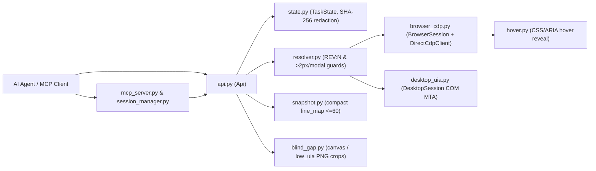

# Architecture

Computer Use Lite (CUL) is organized around a thin Python control API (`Api`), two platform perception/actuation backends (`BrowserSession` over CDP + Playwright and `DesktopSession` over Windows UI Automation), an on-demand visual region cropper (`blind_gap`), a revision-checked target resolver (`Resolver`), atomic redacted state logging (`TaskState`), and a `stdio` Model Context Protocol server (`mcp_server` + `session_manager`).

---

## 1. High-Level Component Flow

---

## 2. Module Responsibilities (`src/computer_use_lite/`)

| Module | Primary Symbols & Responsibility |
| :--- | :--- |
| [`api.py`](../src/computer_use_lite/api.py) | Orchestrates `discover_interactables(target, export_crops, max_elements, filter_query)`, `inspect_element(element_id)`, `execute_action(element_id, action, value, revision, clear)`, `line_map()`, and `last_stats`. Increments `REV:N` per discovery call. |
| [`browser_cdp.py`](../src/computer_use_lite/browser_cdp.py) | Manages Chromium lifecycle (`BrowserSession`), persistent direct CDP WebSocket transport (`DirectCdpClient` using `websockets`), 2-call discovery (`DOMSnapshot.captureSnapshot` + `Accessibility.getFullAXTree`), CSS `overflow` clipping (`P-04`), paint-order occlusion (`P-01`), DOM+AX merging (`P-02`/`P-03`), `elementFromPoint` targeted freshness verification, and `click` / `type` / `select` / `press_key` / `scroll` / `click_coordinate`. |
| [`desktop_uia.py`](../src/computer_use_lite/desktop_uia.py) | Runs Windows UI Automation (`IUIAutomation` / `CUIAutomation8` with `AutoSetFocus=0`) on a **dedicated COM MTA background thread** (`comtypes`). Executes `FindAllBuildCache` discovery, invokes native UIA patterns (`Invoke`, `Toggle`, `Value`, `SelectionItem`, `ExpandCollapse`) with `SendInput` fallback, forces foreground HWND before physical input, enforces `KillSwitch` (5 px cursor excursion abort), and exposes `list_windows()`. |
| [`resolver.py`](../src/computer_use_lite/resolver.py) | Binds `eN` element IDs against the active `REV:N`, verifies identity/geometry drift (`> 2` px bounds shift in `verify_fresh()`), checks modal occlusion/visibility, and raises `StaleElementError` cleanly when state has invalidated. |
| [`snapshot.py`](../src/computer_use_lite/snapshot.py) | Assigns deterministic `e1`, `e2`, ... short IDs, enforces `max_elements` (`60` default), applies `filter_query` substring/role matching, and formats compact `line_map` text (`REV:N\neN role 'name' [x,y,w,h]`). |
| [`blind_gap.py`](../src/computer_use_lite/blind_gap.py) | Detects uncovered semantic gaps: large/unmatched `<canvas>` surfaces (`>= 240x160` px or sparse DOM) or `low_uia` desktop windows (`< 6` controls). Captures bounded crops cleanly, ordering Win32 `PrintWindow` before `ImageGrab` when `hwnd` is covered, minimized, cloaked (`DWMWA_CLOAKED`), or non-foreground (`P-09`). |
| [`hover.py`](../src/computer_use_lite/hover.py) | Dispatches pointer hover onto a resolved element, waits `wait_ms` (`350` ms default), re-discovers, and computes newly revealed hover delta elements. |
| [`state.py`](../src/computer_use_lite/state.py) | Stores runtime snapshots and step telemetry (`TaskState`). Uses atomic temp-file writes (`tempfile.mkstemp` + `os.replace`, configurable `fsync`). Automatically redacts **all** non-`None` action `"value"` payloads to `{value_length, value_sha256, value_redacted: true}`. |
| [`mcp_server.py`](../src/computer_use_lite/mcp_server.py) | Exposes `13` async-friendly `FastMCP` `stdio` tools (`ToolAnnotations`, image `ImageContent` attachment for blind crops) delegating into `SessionManager`. |
| [`session_manager.py`](../src/computer_use_lite/session_manager.py) | Owns multi-session registry, dedicated per-session worker thread dispatch (critical for Playwright greenlet + COM MTA thread affinity), initial host/scheme SSRF checks (`validate_navigation_url()`), viewport/limit clamping, OS Win/Meta hotkey filtering, disposable `TemporaryDirectory` crops/state (`fsync=False`), and `atexit` shutdown cleanup. |
| [`__init__.py`](../src/computer_use_lite/__init__.py) | Exports `Api`, `BrowserSession`, `DesktopSession`, `StaleElementError`, `discover_interactables`, `inspect_element`, `execute_action`, `line_map`. |
| `src/engine/*.py` | Backwards-compatibility alias shims delegating `sys.modules[__name__]` to `computer_use_lite.*`. |

---

## 3. Discovery & Action Lifecycle

### Discovery (`discover` / `discover_interactables`)

1. Target backend scans current UI (`DOMSnapshot` + `AXTree` in browser; `FindAllBuildCache` `ControlView` in Windows UIA).
2. Elements outside viewport bounds or occluded by higher paint-order / Z-order nodes (or ancestor `overflow: hidden|auto|scroll|clip` boxes) are filtered.
3. Redundant `<label for="...">` duplicates and matching nested non-native clickable fragments are collapsed (`P-04`), while `searchbox` and interactive ARIA roles stay intact (`P-03`).
4. `snapshot.py` assigns stable IDs for this scan, increments `REV:N`, filters by `filter_query` if given, caps at `max_elements` (`60` default), and emits text + any `blind_gap` crop artifacts.

### Pre-Action Safety & Execution (`act` / `execute_action`)

1. Caller passes `(element_id, action, value, revision, clear)`.
2. `Resolver` verifies `revision == current_revision`, re-queries targeted element liveness (`verify_fresh`), and fails closed (`StaleElementError`) if the element disappeared, became disabled, moved by `> 2` px, or became covered by another control/modal.
3. Action executes via browser CDP mouse/keyboard or Windows UIA pattern -> `SendInput`, immediately recording SHA-256-redacted history in `TaskState`.
4. Note: `act` returns `"verified": true` based on targeted pre-checks and backend dispatch completion, **not** an extra post-action full DOM/UIA scan unless the caller explicitly calls `discover()`.

---

## 4. Security & Trust Boundaries

CUL enforces defense-in-depth at the MCP & session boundaries, while remaining strictly scoped to **single-user trusted local workstations**:

- **Initial Navigation SSRF Check (`validate_navigation_url`):** Blocks `file://`, `javascript:`, `data:`, `chrome://`, plus IPv4/IPv6 loopback, private RFC1918, CGNAT (`100.64.0.0/10`), link-local metadata (`169.254.169.254`), `metadata.google.internal`, `.local`/`.localhost`, and trailing-dot `localhost.` unless `CUL_MCP_ALLOW_PRIVATE_URLS=1`. *(Residual gaps: Chromium still follows `302` redirects after entry and does independent DNS lookup; see [SECURITY.md](../SECURITY.md).)*
- **Blocked Dangerous OS Keys:** `press_key` rejects `Win`, `LWin`, `RWin`, `Meta`, `Super`, `Command`, and `Cmd` (alone or in chords) before `SendInput`.
- **Bounds Clamping:** Viewport `[200..3840]x[200..2160]`, `limit [1..200]`, `max_elements [1..300]`, and `click_coordinate` rejected outside `[0..vw, 0..vh]`.
- **Chromium CDP Socket:** Chromium `1.64` rejects browser-tab `Origin:` WebSocket CSWSH upgrades (`HTTP 403`), though local origin-less processes on the same host can connect to loopback `--remote-debugging-port`.

See [ARCHITECTURE_DECISION.md](ARCHITECTURE_DECISION.md) for the historical empirical rationale behind every structural decision.
