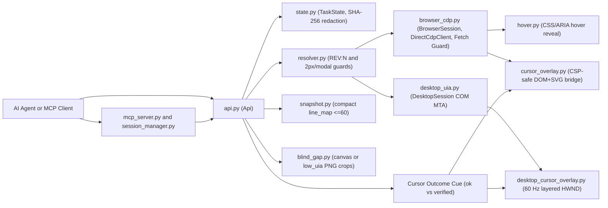

# Architecture (`HEAD` `d47b4e9`)

Computer Use Lite (CUL) pairs a semantic discovery/resolution API (`Api` + `Resolver`) with Chromium CDP and Windows UI Automation backends, on-demand visual gap crops (`blind_gap`), atomic redacted step logging (`TaskState`), a `stdio` Model Context Protocol server (`mcp_server` + `session_manager`), and an optional Frosted Obsidian-Glass & Satin Chrome 3D cursor overlay (`cursor_overlay` + `desktop_cursor_overlay`).

---

## 1. High-Level Component Flow



---

## 2. Module Responsibilities (`src/computer_use_lite/`)

All `13` production modules inside `src/computer_use_lite/`:

| Module | Verified Responsibilities (`[VERIFIED-CODE]` on `HEAD` `d47b4e9`) |
| :--- | :--- |
| [`api.py`](../src/computer_use_lite/api.py) | Implements `discover_interactables()`, `inspect_element()` (`value` read-back on `textbox` and `searchbox`, `"[REDACTED]"` on passwords), `execute_action()` (`click`/`type`/`focus`, `verify_fresh(tolerance=2)`, outcome cursor cues `_notify_cursor_outcome`), `hover_element()`, `line_map()` (`DEFAULT_LINE_MAP_CAP = 60`, `DIALOG_ALERT:` lines for `#32770`), and `last_stats`. |
| [`browser_cdp.py`](../src/computer_use_lite/browser_cdp.py) | Manages Chromium lifecycle (`BrowserSession`), optional `DirectCdpClient` WebSocket transport (`CUL_MCP_DIRECT_WS=0` disables `--remote-debugging-port` and falls back to `_PlaywrightCdpAdapter`), loopback exact-port `--remote-debugging-address=127.0.0.1` + `--remote-allow-origins=http://127.0.0.1:<port>` (`P0-5`), browser/page CDP `Fetch` SSRF interception (`P0-4`), Playwright context multi-tab tracking (`switch_tab`, `close_tab`, `tabs`, `P0-2`), 2-call `DOMSnapshot` + `AXTree` discovery, `overflow` ancestor + `<label>` pruning, candidate-only paint-order occlusion, and `elementFromPoint` pre-action checks. |
| [`desktop_uia.py`](../src/computer_use_lite/desktop_uia.py) | **Windows-only:** dedicated `COINIT_MULTITHREADED` worker running `CUIAutomation8` (`IUIAutomation2` with `AutoSetFocus=0`), transient init `COMError` retry (`d47b4e9`), single-HWND `FindAllBuildCache` discovery, `#32770` static alert collection (`dialog_alerts`) and reliable `_commit_dialog_text` (`SendInput` / `EM_SETSEL`+`WM_CHAR` fallback, `P0-3`), UIA pattern execution -> `SendInput` fallback, `bring_window_to_front`, foreground safety enforcement, `KillSwitch` (5 px tolerance), and `list_windows()`. |
| [`cursor_overlay.py`](../src/computer_use_lite/cursor_overlay.py) | Defines `DESIGN_TOKENS` (Frosted Obsidian-Glass & Satin Chrome, `64x64` artboard, `315` deg key light, `+2.2/+3.0` extrusion offset, `1.6 px` rim), `26+` vector `CURSOR_SPECS`, `resolve_overlay_enabled()`, `resolve_glide_ms()`, `cursor_for_action()`, and a CSP/Trusted-Types-safe DOM+SVG injection bridge for Chromium (`CUL_AGENT_CURSOR`, `CUL_AGENT_CURSOR_GLIDE_MS`). |
| [`desktop_cursor_overlay.py`](../src/computer_use_lite/desktop_cursor_overlay.py) | **Windows-only:** renders the 3D cursor onto a dedicated click-through `WS_EX_LAYERED \| WS_EX_TRANSPARENT \| WS_EX_TOPMOST \| WS_EX_NOACTIVATE` overlay HWND pumped on its own `60.0 Hz` Win32 GUI thread (`DesktopCursorOverlay`), using `_WDA_EXCLUDEFROMCAPTURE` (`0x00000011`) capture exclusion and zero `SendInput` pointer glides so `KillSwitch` never false-triggers (`resolve_desktop_overlay_enabled`, `resolve_desktop_glide_ms`, `is_overlay_hwnd`). |
| [`resolver.py`](../src/computer_use_lite/resolver.py) | Binds `eN` element IDs to monotonic `REV:N`, verifies `tolerance=2` px drift / disabled / occluded / removed checks (`assert_fresh`), raises `StaleElementError`, and reconciles hover delta controls. |
| [`snapshot.py`](../src/computer_use_lite/snapshot.py) | Assigns deterministic `e1`, `e2`, ... short IDs, tracks monotonic revisions (`bump_revision`), queries Win32 window bounds/titles (binds `ctypes.WinDLL("user32")` / `"kernel32"` on import). |
| [`blind_gap.py`](../src/computer_use_lite/blind_gap.py) | Detects `opaque_canvas` (`>= 25%` viewport), `small_opaque_canvas` (`>= 5%` with `<= 2` nearby controls), and desktop `low_uia` (`< 6` controls on area `>= 200,000 px^2`). Captures PNG crops ordering `PrintWindow` before `ImageGrab` when `hwnd` is covered, non-foreground, minimized, or `DWMWA_CLOAKED`. |
| [`hover.py`](../src/computer_use_lite/hover.py) | Performs hover after freshness validation, waits `wait_ms` (`350` ms default), re-discovers, drops disappeared IDs, and returns newly revealed `added` objects. |
| [`state.py`](../src/computer_use_lite/state.py) | Atomic temp-file `TaskState` persistence (`mkstemp` + `os.replace`, configurable `fsync=True|False`). Redacts **all** non-`None` action `"value"` payloads to `{value_length, value_sha256, value_redacted: true}`. |
| [`mcp_server.py`](../src/computer_use_lite/mcp_server.py) | `FastMCP` `stdio` server isolating `sys.stdout` to `sys.stderr`, exposing `13` tools with `ToolAnnotations`, resolving `CUL_MCP_HEADFUL` (`open_browser` `headless=None` default), emitting `HEADLESS:` and `CURSOR:` metadata headers + `list_sessions()` `server_pid`/`headful_default`, and appending up to `4` inline `ImageContent` crops. |
| [`session_manager.py`](../src/computer_use_lite/session_manager.py) | Per-session FIFO `_SessionWorker` thread isolation (`MAX_SESSIONS=16`, `MAX_INLINE_BLIND_IMAGES=4`), disposable scratch `task_state.json` (`fsync=False`) + `crops/`, initial URL & IPv4/IPv6/6to4/Teredo/NAT64 SSRF validation (`validate_navigation_url`), blocked OS modifier keys, and `atexit` cleanup. |
| [`__init__.py`](../src/computer_use_lite/__init__.py) | Exports `Api`, `BrowserSession`, `DesktopSession`, `Resolver`, `StaleElementError`, `detect`, `export`. |
| `src/engine/*.py` | Backwards-compatibility module shims re-exporting core engine modules (`api`, `blind_gap`, `browser_cdp`, `desktop_uia`, `hover`, `resolver`, `snapshot`, `state`). |

---

## 3. Perception, Control & Wire Format Lifecycle

### Discovery & Wire Format (`discover` / `discover_interactables`)
1. **Scan:** Browser executes 2-call CDP `DOMSnapshot.captureSnapshot` + `Accessibility.getFullAXTree` (`browser_cdp.py`); Desktop executes single-HWND `FindAllBuildCache` `ControlView` scan (`desktop_uia.py`).
2. **Prune & Merge:** Filters out-of-viewport, occluded, and scroll-ancestor-clipped controls, deduplicates matching `<label for=...>` and clickable wrappers, and preserves `searchbox`, `textbox`, `combobox`, and interactive ARIA/UIA roles.
3. **Line Map Output:** Increments `REV:N`, detects `blind_gap` regions (skipping crops when `export_crops=False`), and emits compact text (`api.py:78-103` & `mcp_server.py:60-85`):
   ```text
   SESSION:<id> | KIND:<browser|desktop> | ... | HEADLESS:<bool> | CURSOR:<on|off> | LATENCY_MS:<ms> | TOKENS_EST:<n>
   REV:<n> | WIN:<surface> | ELEMENTS:<count> | BLIND_REGIONS:<count>
   DIALOG_ALERT:<static_text>          # emitted on Win32 #32770 dialogs when non-empty static alerts exist
   e1|button|Sign in|420,180,96,36|click
   ... +<m> more elements (use filter_query= or inspect_element)
   blind0|opaque_canvas||260,120,760,420|crop -> <path>
   ```

### Pre-Action Verification & Execution (`act` / `execute_action`)
1. `Resolver` validates `revision == current_revision`.
2. Target backend runs `verify_fresh(rec, tolerance=2)` (re-checking DOM connection / UIA presence, bounds drift `<= 2` px, disabled state, and browser `elementFromPoint` occlusion -> `StaleElementError` on failure).
3. Action executes (Browser CDP/Playwright or Desktop UIA patterns -> `#32770` `_commit_dialog_text` / `SendInput`), then `state.verify(before, after)` checks signature deltas (`verified` telemetry) and notifies cursor outcome cues (`ok` vs `verified` separated in `api.py:145`).
4. Every mutating tool (`act`, `hover`, `navigate`, `scroll`, `press_key`, `click_at`) advances `REV:N` so older sibling IDs cannot be reused blindly.

---

## 4. Cursor Overlay Architecture (`Workstream A`)

- **Trigger & Configuration:** Headless `open_browser` runs keep the overlay disabled (`resolve_overlay_enabled(headless=True) -> False`) unless `show_cursor=True` or `CUL_AGENT_CURSOR=1` is passed; headful browser sessions (`headless=False` or `CUL_MCP_HEADFUL=1`) and Windows `DesktopSession` runs enable the overlay by default unless `CUL_AGENT_CURSOR=0` or `CUL_SKIP_DESKTOP=1`. Glide speed defaults to `0 ms` (headless), `140 ms` (headful browser), and `160 ms` (desktop), clamped to `0..600 ms` (`CUL_AGENT_CURSOR_GLIDE_MS`).
- **Browser Isolation:** Uses DOM APIs and SVG vector elements inside `cursor_overlay.py` so strict CSP and Trusted Types policies do not break injection; excluded from discovery parsing (`test_zero_discovery_leakage_*`).
- **Desktop Isolation:** Runs `DesktopCursorOverlay` on a dedicated `60.0 Hz` Win32 GUI message loop rather than `DesktopSession`'s COM MTA thread, flags the window `WS_EX_TRANSPARENT | WS_EX_NOACTIVATE | WS_EX_TOPMOST | WS_EX_LAYERED` plus `_WDA_EXCLUDEFROMCAPTURE`, and animates cursor frames cleanly without moving OS pointer hardware (`SendInput` never invoked during glides).

---

## 5. Multi-Tab & Security Boundaries (`P0-2`, `P0-4`, `P0-5`)

- **Multi-Tab Context Tracking (`P0-2`):** `BrowserSession._bind_context_pages` tracks new/popup tabs in the Playwright browser context (`tabs()`), and MCP `navigate` exposes `action="list_tabs"`, `"switch_tab"`, and `"close_tab"` (`tab_index: int | None`), rebinding `DirectCdpClient` and re-mounting the cursor overlay on switch.
- **Navigation & Redirect SSRF Defense (`P0-4`):** `validate_navigation_url` normalizes hosts and rejects private/loopback/link-local/CGNAT/reserved IPv4 and IPv4-mapped/6to4/Teredo/NAT64 IPv6 literals by default (`CUL_MCP_ALLOW_PRIVATE_URLS=1` opt-in). In `BrowserSession`, `_install_browser_fetch_guard` enables CDP `Fetch` at both request and response (`3xx` `Location`) stages and fails blocked targets with `BlockedByClient`. *(OS-level DNS-rebinding TOCTOU remains open — see [SECURITY.md](../SECURITY.md).)*
- **CDP Origin Hardening (`P0-5`):** Self-launched `DirectCdpClient` browsers bind `--remote-debugging-address=127.0.0.1` with `--remote-allow-origins=http://127.0.0.1:<port>`, and `CUL_MCP_DIRECT_WS=0` disables the loopback TCP port in favor of `_PlaywrightCdpAdapter`.

---

## 6. Implemented vs. Proposed Architecture Boundary

Features documented above exist in `HEAD` (`d47b4e9`). By contrast, items labeled **`P1`** and **`P2`** in historical trace planning (e.g., AX `checked`/`slider`/`readonly` enrichment, unified `_visible_click_point`, `WS_EX_LAYOUTRTL` un-mirroring in `PrintWindow`, Explorer `CabinetWClass` inactive-tab filtering, Linux/macOS `WinDLL` lazy decoupling, continuous pointer `drag`, and live multi-model VLM runs on `bench_agent_20tasks.py`) are **NOT implemented** — see [OPTIMIZATION_ROADMAP.md](OPTIMIZATION_ROADMAP.md) and [KNOWN_LIMITATIONS.md](KNOWN_LIMITATIONS.md).

Decision rationale: [ARCHITECTURE_DECISION.md](ARCHITECTURE_DECISION.md).
