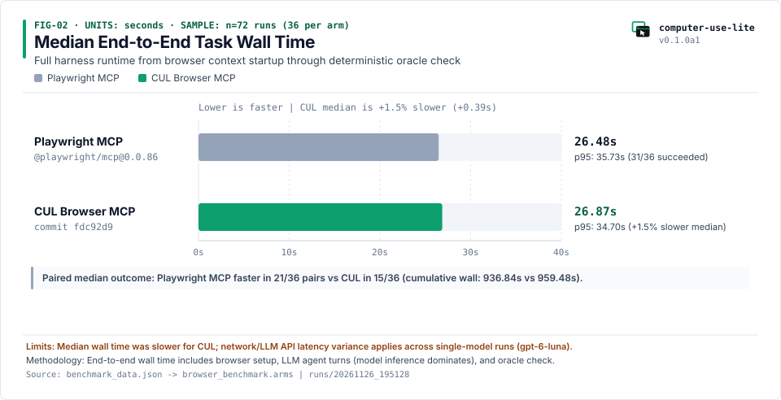
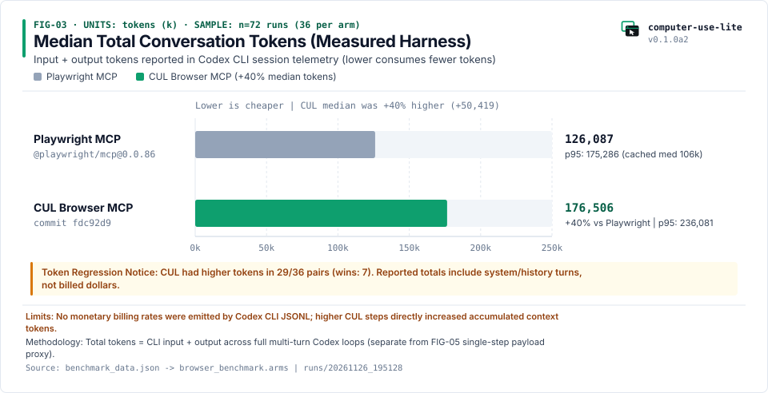
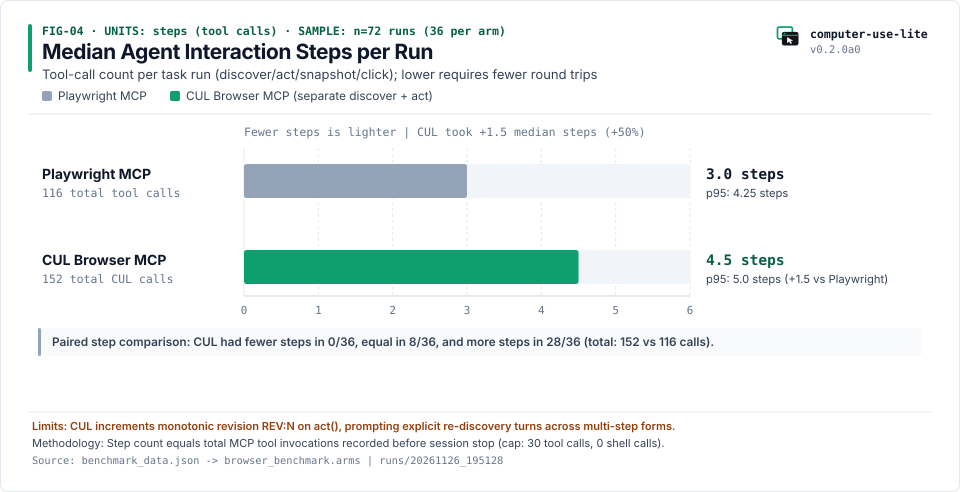

# Computer Use Lite — Benchmark Comparison (`v0.1.0a2`)

> [!IMPORTANT]
> **Comparison Boundary:** The paired browser study compared **two semantic browser MCP tools** (`@playwright/mcp@0.0.86` accessibility snapshots vs **CUL Browser MCP** at commit `fdc92d9` under `CUL_MCP_BROWSER_ONLY=1`). It is **NOT** a Native OpenAI Computer Use (`@oai/sky`) vs CUL comparison, and it is **NOT** an evaluation of Windows Desktop UIA. Every figure below is generated from [../research_archive/benchmark_publication/benchmark_data.json](../research_archive/benchmark_publication/benchmark_data.json).

---

## 1. Browser Agent Benchmark (`72` Runs — Commit `fdc92d9`)

### FIG-01 — Browser Task Success Rate

- **TSX Source:** [`Fig01BrowserSuccess.tsx`](../research_visuals/benchmark_report/src/figures/Fig01BrowserSuccess.tsx) · **PNG Preview:** [`fig-01-browser-success.png`](assets/benchmarks/fig-01-browser-success.png) · **Methodology:** [BENCHMARK_METHODOLOGY.md](BENCHMARK_METHODOLOGY.md)
- **Disclosed Confound:** Task `b11_dense_90_grid_filter` shared prompt text exposed CUL's parameter name (`filter_query`) to both arms, and Playwright MCP called `browser_run_code_unsafe` once on `b12_opaque_canvas_click` run 1.

### FIG-02 — Median End-to-End Task Wall Time

- **TSX Source:** [`Fig02WallTime.tsx`](../research_visuals/benchmark_report/src/figures/Fig02WallTime.tsx) · **PNG Preview:** [`fig-02-wall-time.png`](assets/benchmarks/fig-02-wall-time.png)
- Lower wall time is faster. CUL's median end-to-end duration (`26.87s`, p95 `34.70s`) was `+1.5%` slower than Playwright MCP (`26.48s`, p95 `35.73s`).

### FIG-03 — Median Total Conversation Tokens

- **TSX Source:** [`Fig03TokenEstimates.tsx`](../research_visuals/benchmark_report/src/figures/Fig03TokenEstimates.tsx) · **PNG Preview:** [`fig-03-token-estimates.png`](assets/benchmarks/fig-03-token-estimates.png)
- Lower token total uses less context. CUL consumed `+40.0%` more median total conversation tokens (`176,506` vs `126,087`) due to revision-checked `discover` + `act` turns.

### FIG-04 — Median Interaction Steps

- **TSX Source:** [`Fig04InteractionSteps.tsx`](../research_visuals/benchmark_report/src/figures/Fig04InteractionSteps.tsx) · **PNG Preview:** [`fig-04-interaction-steps.png`](assets/benchmarks/fig-04-interaction-steps.png)
- CUL executed `4.5` median steps (`152` total calls) vs Playwright MCP's `3.0` median steps (`116` total calls).

### Summary & Per-Task Breakdown

| Metric | Playwright MCP | CUL Browser MCP (`fdc92d9`) | Paired Outcome / Notes |
|---|---:|---:|---|
| **Successful runs** | `31/36` (`86.11%`) | `36/36` (`100.0%`) | `+5` CUL paired wins (`5W / 0L / 31T`) |
| **95% Wilson CI** | `71.34% – 93.92%` | `90.36% – 100.0%` | Confidence intervals overlap above `90%` |
| **Median total tokens** | `126,087` | `176,506` | CUL `+40.0%` higher (`7W / 29L`) |
| **Median steps** | `3.0` | `4.5` | CUL `+50.0%` more calls (`0W / 28L / 8T`) |
| **Median wall time** | `26.48s` | `26.87s` | CUL `+1.5%` slower median (`15W / 21L`) |

Notable task divergence: Playwright MCP failed `b08_closed_shadow_dom` (`0/3`) and partially failed `b12_opaque_canvas_click` (`1/3`, succeeding once via `browser_run_code_unsafe`), while CUL completed `3/3` on both using CDP closed-Shadow-DOM snapshot visibility and `blind_gap` canvas crops — at higher median step/token cost across the other `10` tasks.

---

## 2. Semantic Observation Size Proxy (`FIG-05`)

- **TSX Source:** [`Fig05ObservationSize.tsx`](../research_visuals/benchmark_report/src/figures/Fig05ObservationSize.tsx) · **PNG Preview:** [`fig-05-observation-size.png`](assets/benchmarks/fig-05-observation-size.png)
- **Label:** `Estimated Observation Size — Not Actual API Token Usage`.
- `112` estimated tokens (`round(text_length / 4)`) vs `1,196` `28×28`-patch tokens (`1280×720`) reflects **single-step discovery payload proxies on synthetic fixtures**, not total billed provider tokens (see `FIG-03`, where total multi-turn Codex tokens were `+40%` higher for CUL, and [BENCHMARKS.md](BENCHMARKS.md), where uncapped File Explorer reached `1,611.0` estimated tokens).

---

## 3. Windows Automated Test Coverage (`FIG-06`)

- **TSX Source:** [`Fig06WindowsTests.tsx`](../research_visuals/benchmark_report/src/figures/Fig06WindowsTests.tsx) · **PNG Preview:** [`fig-06-windows-tests.png`](assets/benchmarks/fig-06-windows-tests.png)
- Recorded on Windows 11 Pro (`10.0.26200`) at commit `0d19a9e`: `70 passed, 0 failed, 0 skipped` in `197.50s` (`58 passed, 12 skipped` in `86.66s` under `CUL_SKIP_DESKTOP=1`). This measures deterministic test coverage, **not** AI-agent performance.

---

## 4. Desktop Pilot Status (`FIG-07`)

- **TSX Source:** [`Fig07DesktopPilotStatus.tsx`](../research_visuals/benchmark_report/src/figures/Fig07DesktopPilotStatus.tsx) · **PNG Preview:** [`fig-07-desktop-pilot-status.png`](assets/benchmarks/fig-07-desktop-pilot-status.png)
- **Status:** `CUL T1` passed `2/2` supervised runs with fixture SHA-256 checks; `CUL T2` remained **incomplete**; and the **Native vs CUL desktop comparison was never completed**. A standalone pre-pilot Native Calculator smoke check is not a comparative benchmark.
