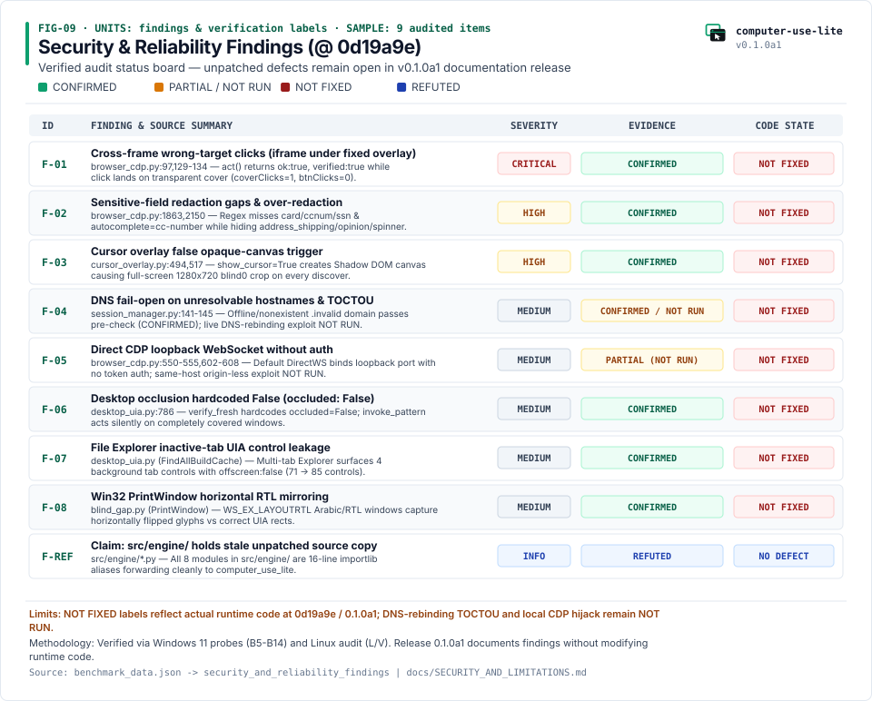
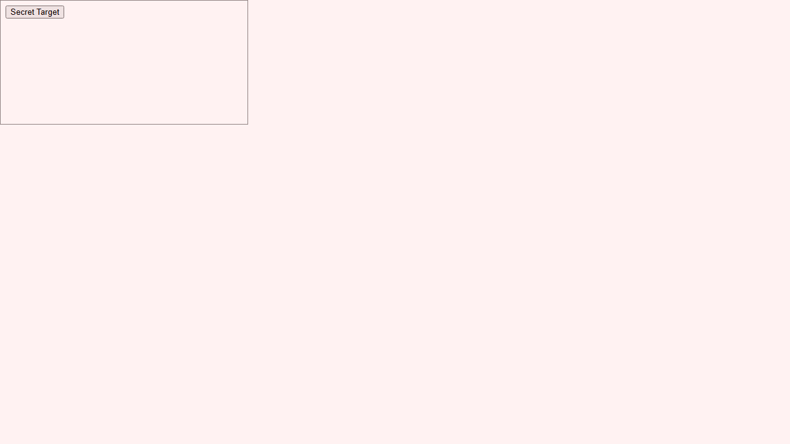
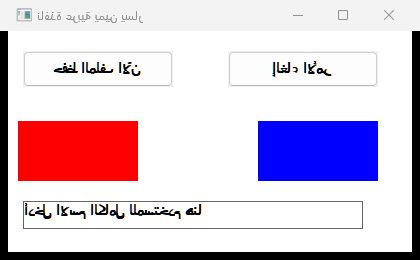

# Security Findings, Remediations & Open Boundaries (`v0.2.0a0`)

> [!IMPORTANT]
> **Post-Fix Verification (`a33a8f2`):** Release `v0.2.0a0` remediates `F-01`–`F-03` & `F-05`–`F-08`, mitigates `F-04` (`gaierror` fail-closed + rebind cache; Chromium socket DNS TOCTOU boundary open), and resolves the `P1`–`P3` + Cursor findings verified across [`post-fix-v1`](../research/benchmarks/post-fix-v1/REPORT.md) (`32/32` Track A, `18/18` Track B2, `95/95` Win11 pytest, WSL2 Python 3.14.7 import).

---

## 1. Audited Security & Reliability Remediation Board (`FIG-09`)

- **TSX Source:** [`Fig09SecurityFindings.tsx`](../research_visuals/benchmark_report/src/figures/Fig09SecurityFindings.tsx) · **PNG Preview:** [`fig-09-security-findings.png`](assets/benchmarks/fig-09-security-findings.png) · **Policy:** [`SECURITY.md`](../SECURITY.md)

| ID | Finding | Severity | `0d19a9e` State | `v0.2.0a0` State | Verified Remediation Pointer (`a33a8f2`) |
| :--- | :--- | :--- | :--- | :--- | :--- |
| **F-01** | Cross-frame wrong-target click (`position:fixed` overlay over `iframe`) | **Critical** | `NOT FIXED` | **`FIXED & VERIFIED`** | `src/computer_use_lite/browser_cdp.py:1860` (`_verify_top_frame_hit`) |
| **F-02** | Secret regex misses `card`/`ccnum`/`ssn` & over-redacts benign words + deterministic hash | **High** | `NOT FIXED` | **`FIXED & VERIFIED`** | `src/computer_use_lite/state.py:44,72`, `browser_cdp.py:51,2465,2539` |
| **F-03** | `show_cursor=True` Shadow DOM `<canvas>` triggers false `opaque_canvas` crop | **High** | `NOT FIXED` | **`FIXED & VERIFIED`** | `src/computer_use_lite/browser_cdp.py` (`canvas_rects`) + `cursor_overlay.py` |
| **F-04** | `validate_navigation_url` fails open on DNS errors; Chromium socket TOCTOU | **Medium** | `NOT FIXED` | **`MITIGATED & BOUNDED`** | `src/computer_use_lite/session_manager.py:82` (fail-closed `gaierror` + IP drift; Chromium socket DNS TOCTOU open) |
| **F-05** | Direct loopback CDP WebSocket enabled without auth by default | **Medium** | `NOT FIXED` | **`FIXED & VERIFIED`** | `src/computer_use_lite/browser_cdp.py:613` (`Pipe` IPC default, `CUL_MCP_DIRECT_WS=1` opt-in) |
| **F-06** | Desktop `verify_fresh` hardcodes `occluded: False`; `KillSwitch` init fail-open | **Medium** | `NOT FIXED` | **`FIXED & VERIFIED`** | `src/computer_use_lite/desktop_uia.py:239,885`, `blind_gap.py:76` |
| **F-07** | File Explorer (`CabinetWClass`) background tab controls leak (`71 -> 85`) | **Medium** | `NOT FIXED` | **`FIXED & VERIFIED`** | `src/computer_use_lite/desktop_uia.py:572` (`_inactive_explorer_tab_hwnds`) |
| **F-08** | Win32 `PrintWindow` horizontally mirrors `WS_EX_LAYOUTRTL` windows | **Medium** | `NOT FIXED` | **`FIXED & VERIFIED`** | `src/computer_use_lite/blind_gap.py:187` (`ImageOps.mirror`) |
| **F-REF** | Claim that `src/engine/` holds a stale duplicate source copy | **Info** | `NO DEFECT` | **`NO DEFECT` (`REFUTED`)** | `src/engine/*.py` (`16`-line `importlib` aliases) |

Additional verified remediations landed in `v0.2.0a0` (see [`docs/releases/v0.2.0a0/ENGINEERING_CHANGE_HISTORY.md`](releases/v0.2.0a0/ENGINEERING_CHANGE_HISTORY.md)):
- `validate_desktop_target` blocklist + `validate_key_spec` blocking `Alt+Tab`/`Alt+F4`/`Ctrl+Esc`/`Ctrl+Shift+Esc` (+ Win11 Arabic `VkKeyScanW` ASCII fallback).
- Guarded Win32 imports (`snapshot.py`, `desktop_uia.py`, `desktop_cursor_overlay.py`) verified on WSL2 `kali-linux` (`Python 3.14.7`) + `[UNTRUSTED_UI_TEXT]` delimiter sanitization + `psutil>=6.0` in `[dev]`.
- Target-bound `verify(before, after, action=...)` with full-body `innerText` FNV-1a digesting past 400 chars, `<input type=date>` prototype fill, sticky-header safe offset clicking, adaptive hover (`387.39 ms -> 90.83 ms`), `act(drag)` / `read_page`, and idle TTL session reaping.

---

## 2. Historical Baseline Audit Evidence (`0d19a9e`, Unaltered)

The synthetic local baseline reproductions below document why `F-01` and `F-08` existed in `0d19a9e` prior to `v0.2.0a0`:

### F-01 Baseline Repro (`0d19a9e`): Cross-Origin `iframe` Under Fixed Overlay

*Baseline (`0d19a9e`): `act()` returned `ok:true, verified:true` with `coverClicks=1, btnClicks=0`. In `v0.2.0a0`, `verify_fresh` raises `StaleElementError` (`0` leaks in `A01`, `A03`, `s03`).*

### F-08 Baseline Repro (`0d19a9e`): Win32 `PrintWindow` RTL Mirroring
| Normal LTR Test Window | `WS_EX_LAYOUTRTL` Mirrored Capture (`0d19a9e`) |
| :---: | :---: |
|  |  |

---

## 3. Open Benchmark, Hook & Platform Boundaries (`v0.2.0a0`)

- **Track B1 Live LLM Benchmarks (`NOT_RUN`):** `codex-cli 0.166.0` exhausted usage limit until Dec 26, 2026 and `@oai/sky` / cloud API keys are absent.
- **Hardware OS Hooks in `exebox` (`NOT VERIFIED`):** Physical `GetCursorInfo()` cursor flicker and low-level `WH_KEYBOARD_LL` `Esc` interrupt hooks require unlocked interactive `WinSta0\Default` and return `ERROR_ACCESS_DENIED` inside `exebox`.
- **Desktop Pilot `T2` & Live Public Embeds:** Multi-step Store Calculator `T2` workflow and live third-party embeds (`youtube.com/embed`) remain unverified end-to-end.
- **Chromium Internal DNS Rebinding TOCTOU:** Python pre-checks fail closed on `gaierror` and IP drift, while Chromium internal socket DNS resolution remains outside Python control.

For full line-level verification see [`research/audits/post-fix-v0.2.0a0/POST_FIX_AUDIT_REPORT.md`](../research/audits/post-fix-v0.2.0a0/POST_FIX_AUDIT_REPORT.md), [`KNOWN_LIMITATIONS.md`](KNOWN_LIMITATIONS.md), and [`../SECURITY.md`](../SECURITY.md).
