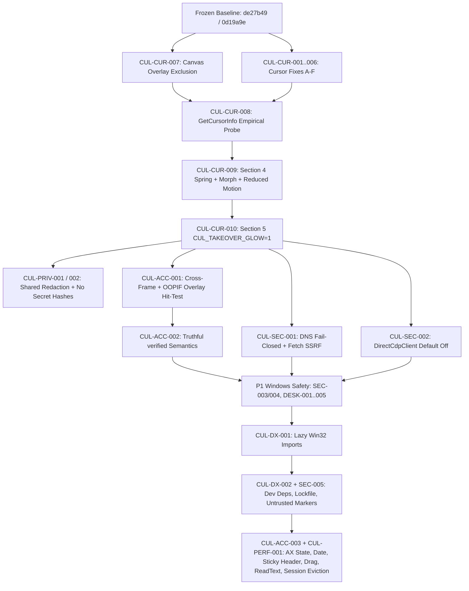

# Repair Dependency Graph

## Explicit Conflict Resolutions
1. **`CUL-SEC-002` (`CUL_MCP_DIRECT_WS=0`) vs Latency:** Keeping Playwright `CDPSession` default prioritizes local security; `CUL_MCP_DIRECT_WS=1` remains selectable for controlled benchmark/opt-in measurements (`Exp 7` tradeoff documented).
2. **Additive P3 Features (`drag`, `read_page`) vs `test_mcp_tool_roster_annotations_and_browser_workflow`:** Rather than breaking clients expecting the exact 13-tool MCP roster (`open_browser`, ..., `click_at`), expose `drag` via `act(..., action="drag", ...)` and static text via `discover(..., include_static_text=True)` + Python `Api.drag()` / `Api.read_page()`. Zero breaking schema churn!
3. **`CUL-CUR-008` (`GetCursorInfo`) Conditional Fix:** We only touch Win32 cursor hiding (`ShowCursor` / cursor blanking) if the empirical Win11 log proves the real cursor flashes/overrides during `SendInput`.
